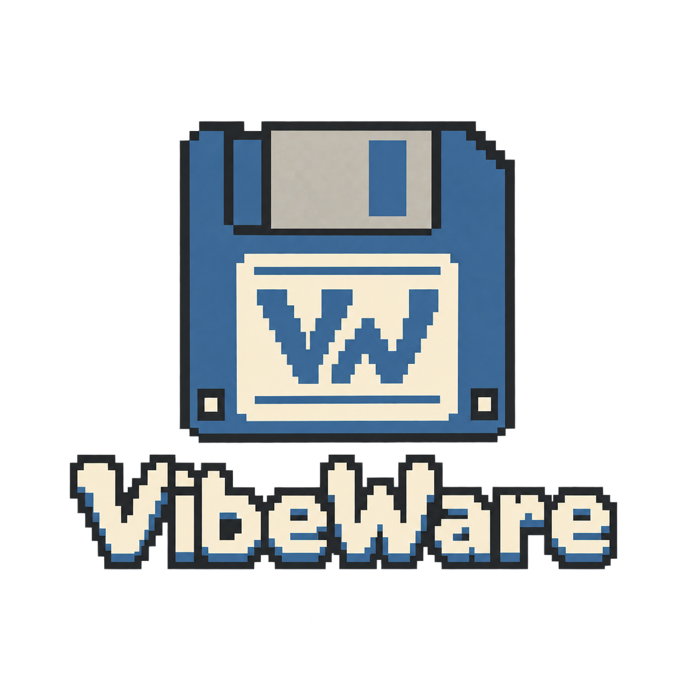

# Vibe Panel

I'm [Umberto Giacobbi](https://umbertogiacobbi.biz). Vibe Panel puts music and Codex activity on a small USB screen.

I made it in a few days, on holiday. I was frustrated with my display's software. Other open-source apps didn't suit me, so I learned from their work and made my own. [Credits](docs/protocol-notes.md#sources-studied).

It's still rough. I shared it because it may help someone.

I used AI to help write it. **Memory, speed and security checks are still on my list.** I haven't had time to finish them yet.

**Themes run Python code on your PC. For now, only get them from [this official repo](https://github.com/umbertotechnopreneur/VibePanel).**

For now, it runs on Windows. [How to use it](PORTABLE.md) · [What's left to do](cave.md).

System themes have rotating gauges, charts and cooling pages. Music themes can show an [artist photo and short biography](docs/artist-pages.md) from public online sources. Missing data stays hidden.

This is my hobby project. [MIT license](LICENSE). No warranty.

---

Part of my VibeWare initiative. [My manifesto](https://umbertogiacobbi.biz/vibeware/manifesto).

[Terms](https://umbertogiacobbi.biz/terms/) · [Privacy](https://umbertogiacobbi.biz/privacy/)

## External binary security policy

Before including any third-party prebuilt binary or compiled library in this
repository or its deliverables, including files supplied without source code,
run an explicit targeted Microsoft Windows Defender scan of the downloaded
package/archive and all extracted files and required dependencies that will be
used. Keep them staged until the scan finishes; real-time protection alone is
not enough.

Proceed only after the scan completes without detections. Record the official
source, version or SHA-256, scan command and result. An unavailable, disabled,
failed or unfinished scan, or any detection, blocks import. Do not bypass a
detection with exclusions, allowlisting, restored quarantine items or disabled
protection without separate explicit owner approval.

This rule applies to future imports; it does not certify existing dependencies.
Reuse recorded SHA-256 evidence for unchanged imports. Builds check that evidence
and never start scans. See the [build guide](installer/README.md) for explicit
first-import preparation. Generated app files are not external imports.
