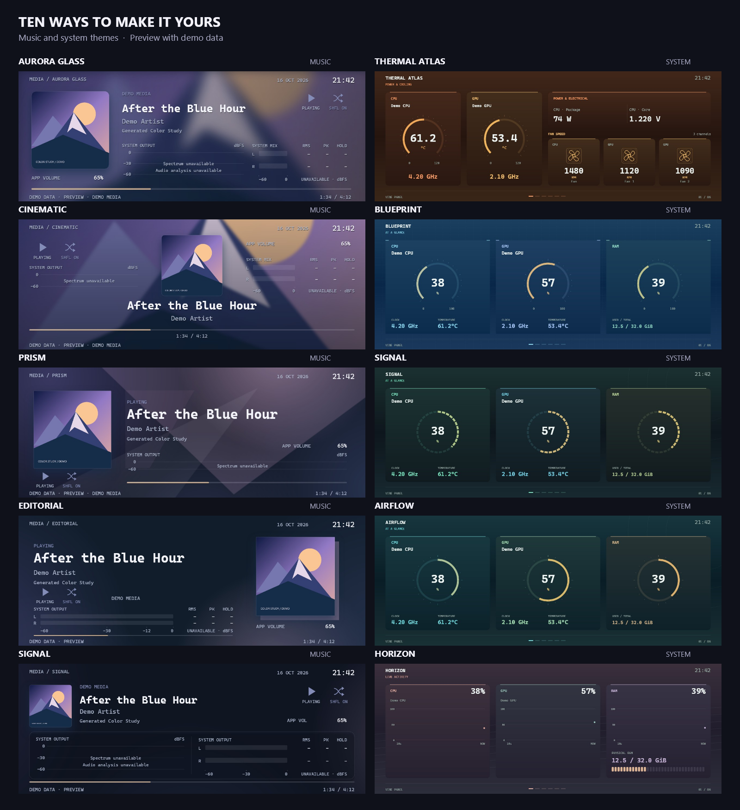

# Vibe Panel

I made Vibe Panel to put music and PC information on a small USB screen. I'm [Umberto Giacobbi](https://umbertogiacobbi.biz).

- **Music:** See the song and artwork from Spotify and other players that share a Windows media session.
- **Your PC:** See available CPU, GPU, RAM, temperatures, power and fan readings. What you see depends on your hardware and sensor access.
- **Codex:** Try the early Codex themes. This part still needs work.

I built this for my Thermalright Trofeo Vision LCD, a 6.86-inch USB screen (1280 × 480). Thermalright sells it in [black](https://www.thermalright.com/product/trofeo-vision-lcd-black/) and [white](https://www.thermalright.com/product/trofeo-vision-lcd-white/). [Hardware details](docs/protocol-notes.md).

Vibe Panel is an independent project. It is not connected with or endorsed by Thermalright. All trademarks belong to their respective owners.

## Get it

[Download Vibe Panel 0.1](https://github.com/umbertotechnopreneur/VibePanel/releases/tag/0.1). On Windows, pick the MSI for your PC: **x64** or **ARM64**. Open it and follow the steps. A portable ZIP is available too.

**On Windows, run Vibe Panel as administrator.** CPU and motherboard temperatures and fan RPM also need the **PawnIO driver**. Install its official signed edition from the [PawnIO releases page](https://github.com/namazso/PawnIO.Setup/releases/latest): open **Assets** and download `PawnIO_setup.exe`. Vibe Panel does not install this driver.

Windows is the supported platform today. Linux and macOS do not yet have USB or audio support. CPU and motherboard sensor access on Windows ARM64 is still unavailable. [How to use Vibe Panel](PORTABLE.md) · [Sensor setup](docs/sensors.md) · [Current limits](cave.md).

**Themes run Python code on your PC. For now, only download themes from [this official repository](https://github.com/umbertotechnopreneur/VibePanel).**

I made this hobby project in a few days on holiday because I wanted lighter display software that I could change to suit me. I learned from other people's public work and used AI to help write it. [Credits](docs/protocol-notes.md#sources-studied).

The software is open source under the [MIT license](LICENSE); the hardware is sold separately. Some included components have their own [licenses](THIRD_PARTY_NOTICES.md). This is a hobby project, with no warranty.

You are welcome to try it with other screens, use the code and share what you learn. I cannot offer support because I do not have the time.

## More tools

[VoiceDucker](https://github.com/umbertotechnopreneur/VoiceDucker) · [Ulanzi Dock](https://github.com/umbertotechnopreneur/ulanzi-dock-vibeware)

## A note on security

I care about what goes into this project. Before I add a third-party library or prebuilt binary, including files supplied without source code, I scan the downloaded package, its extracted files and any dependencies with Microsoft Windows Defender. I keep new imports aside until the scan finishes without detections.

I keep a record of where each new import came from and the scan result. If a scan cannot finish or flags something, I leave it out.

---

Part of my VibeWare initiative. [My manifesto](https://umbertogiacobbi.biz/vibeware/manifesto).

[Terms](https://umbertogiacobbi.biz/terms/) · [Privacy](https://umbertogiacobbi.biz/privacy/)

   
  <em>Human Intent, AI Execution, Plenty of Token</em>

