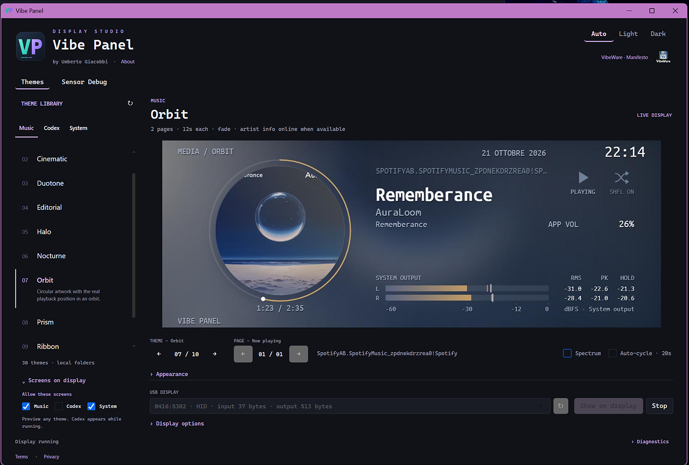
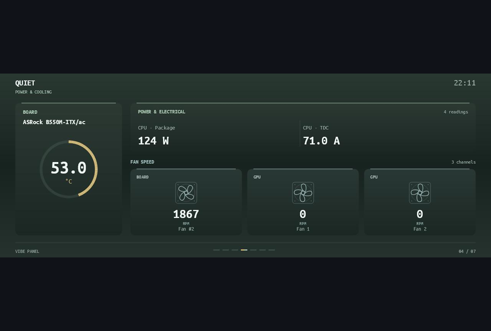
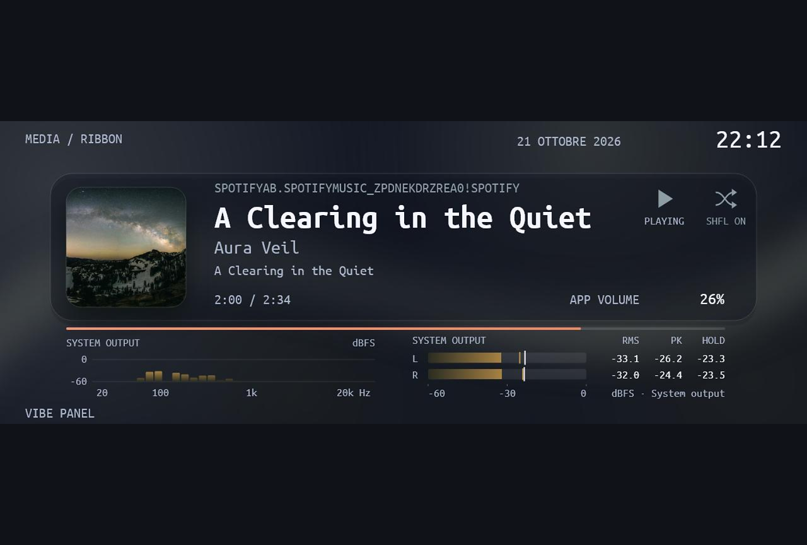
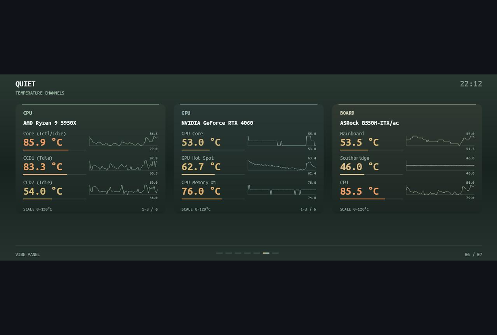
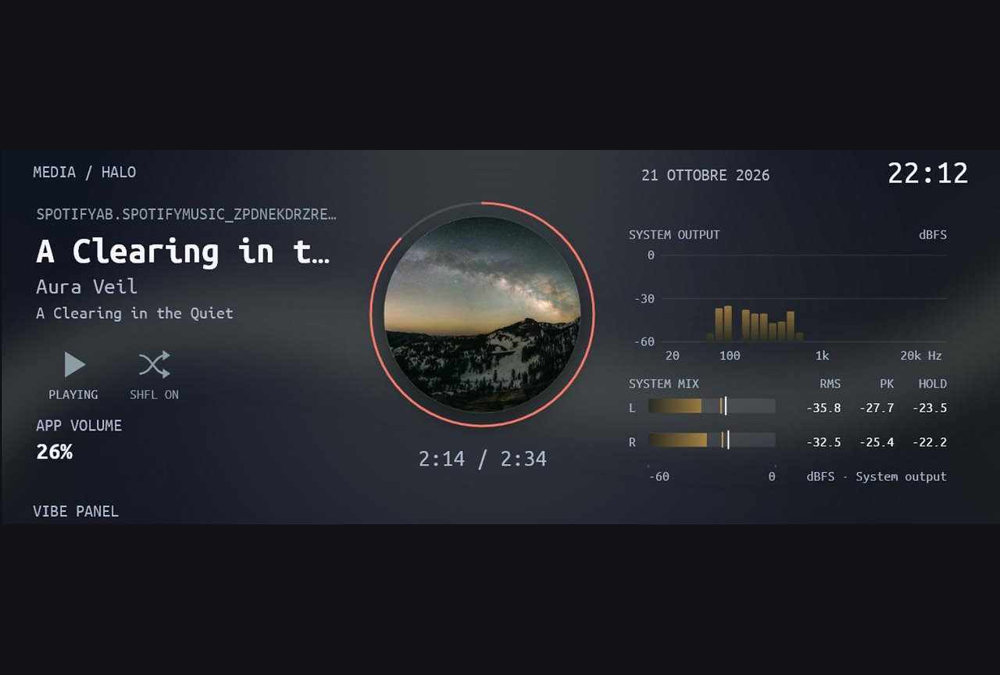
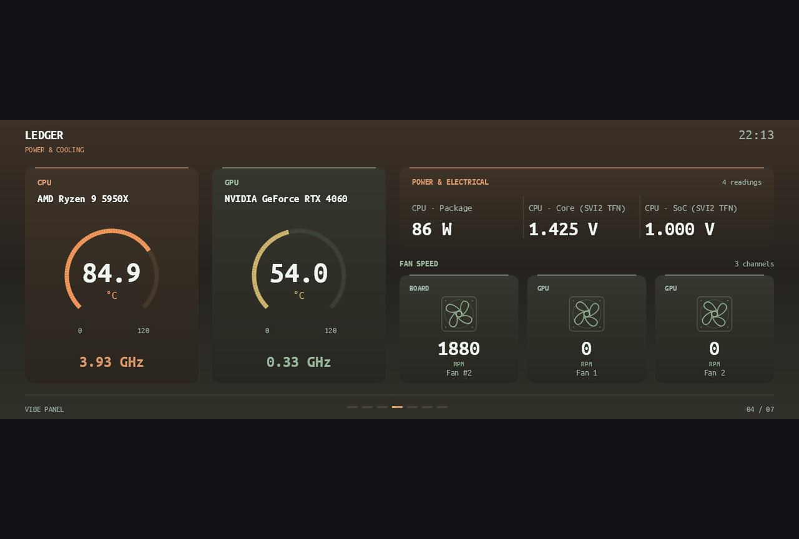
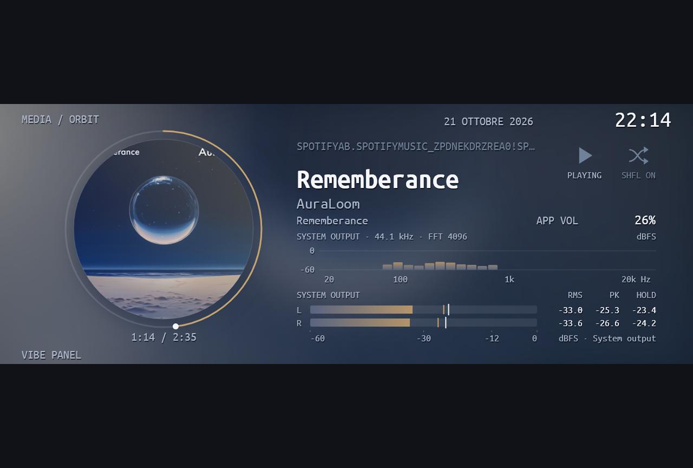
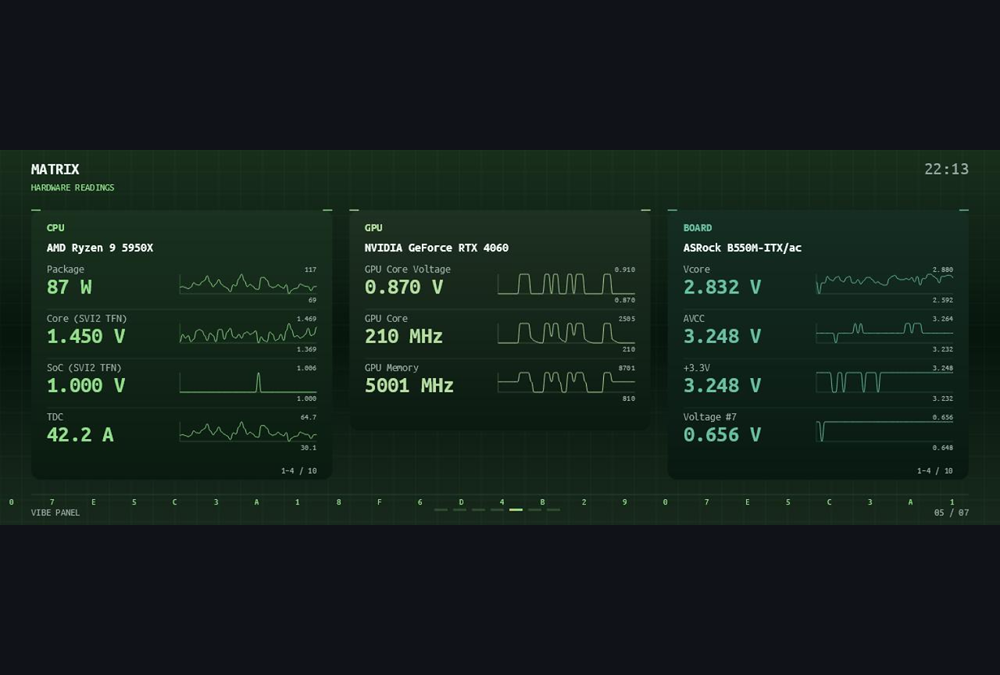
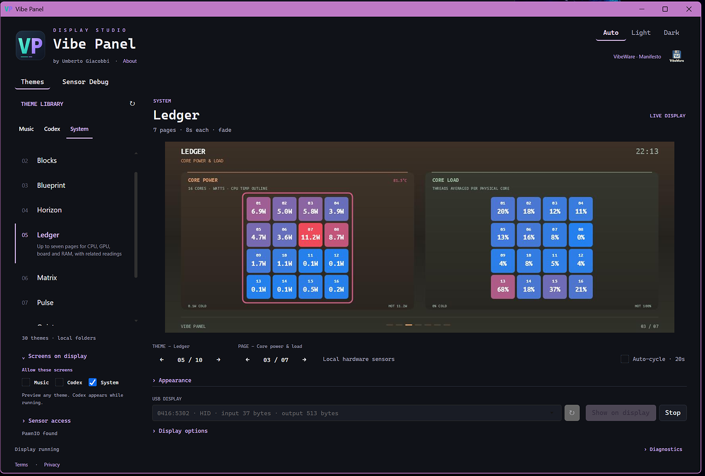

# Thermalright VibeWare

I made this free, open-source app for my Thermalright Trofeo Vision LCD. It puts music, artwork and PC sensor readings on the screen. I'm [Umberto Giacobbi](https://umbertogiacobbi.biz).

*Real screenshots from the running app, captured before the rename. Cropped and resized, with light sharpening. No AI-generated or AI-retouched UI.*

- **Music:** See the song and artwork from Spotify and other players that share a Windows media session.
- **Your PC:** See available CPU, GPU, RAM, temperatures, power and fan readings. What you see depends on your hardware and sensor access.
- **Codex:** Show local activity with the optional Codex plugin.

I built this for my Thermalright Trofeo Vision LCD, a 6.86-inch USB screen (1280 × 480). Thermalright sells it in [black](https://www.thermalright.com/product/trofeo-vision-lcd-black/) and [white](https://www.thermalright.com/product/trofeo-vision-lcd-white/). [Hardware details](docs/protocol-notes.md).

This is an independent, unofficial project. I do not work for Thermalright, and I am not affiliated with or sponsored by Thermalright. Thermalright does not endorse this project. All trademarks and registered trademarks belong to their respective owners.

## Get it

[Downloads](https://github.com/umbertotechnopreneur/thermalright-vibeware/releases). On Windows, choose the **x64** or **ARM64** MSI for your PC and follow the steps. For a portable ZIP, extract the whole folder before opening the app.

**On Windows, run Thermalright VibeWare as administrator.** CPU and motherboard temperatures and fan RPM also need the **PawnIO driver**. Install its official signed edition from the [PawnIO releases page](https://github.com/namazso/PawnIO.Setup/releases/latest): open **Assets** and download `PawnIO_setup.exe`. Thermalright VibeWare does not install this driver.

**Linux and macOS guinea pigs wanted! 🐹** Want to help try it on your computer? [Share what you find](https://github.com/umbertotechnopreneur/thermalright-vibeware/issues).

[How to use Thermalright VibeWare](PORTABLE.md) · [Sensor setup](docs/sensors.md).

**Themes run Python code on your PC. For now, only download themes from [this official repository](https://github.com/umbertotechnopreneur/thermalright-vibeware).**

I made this hobby project in a few days on holiday because I wanted lighter display software that I could change to suit me. I learned from other people's public work and used AI to help write it. [Credits](docs/protocol-notes.md#sources-studied).

The software is open source under the [MIT license](LICENSE); the hardware is sold separately. Some included components have their own [licenses](THIRD_PARTY_NOTICES.md). This hobby project is provided as is, without any warranty.

You are welcome to try it with other screens, use the code and share what you learn.

## Screenshots

These are app captures, not photographs of a physical display. The studio preview shows the frame prepared for the display.

| System | Music |
| --- | --- |
|  |  |
|  |  |
|  |  |
|  |  |

## More tools

[VoiceDucker](https://github.com/umbertotechnopreneur/VoiceDucker) · [Ulanzi Dock](https://github.com/umbertotechnopreneur/ulanzi-dock-vibeware)

## A note on security

I care about what goes into this project. Before I add a third-party library or prebuilt binary, including files supplied without source code, I scan the downloaded package, its extracted files and any dependencies with Microsoft Windows Defender. I keep new imports aside until the scan finishes without detections.

I keep a record of where each new import came from and the scan result. If a scan cannot finish or flags something, I leave it out.

---

Part of my VibeWare initiative. [My manifesto](https://umbertogiacobbi.biz/vibeware/manifesto).

[Terms](https://umbertogiacobbi.biz/terms/) · [Privacy](https://umbertogiacobbi.biz/privacy/)

  

